# Lizmap Web Client 3.10

## Nouvelles fonctionnalités

### Géolocalisation

L'option de géolocalisation s'enrichit de deux nouveautés : l'affichage d'une **flèche** indiquant la direction du déplacement ([#6167](https://github.com/3liz/lizmap-web-client/pull/6167)) et la **rotation de la carte** pendant le suivi de la position ([#6834](https://github.com/3liz/lizmap-web-client/pull/6834)).

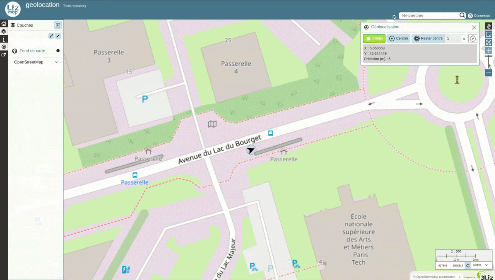

*Financé par Terre de Provence Agglomération - Développé par [René-Luc D'Hont](https://github.com/rldhont) & [Nicolas Boisteault](https://github.com/nboisteault)*

### Panoramax

Nouvelle visionneuse **Panoramax** intégrée à la carte, qui permet d'afficher directement dans Lizmap les photos géolocalisées d'une couche Panoramax ([#6904](https://github.com/3liz/lizmap-web-client/pull/6904)).

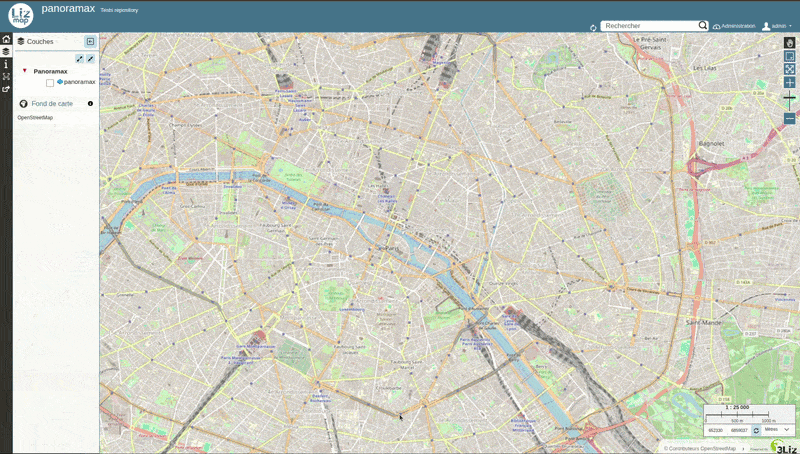

*Financé par Terre de Provence Agglomération - Développé par [Nicolas Boisteault](https://github.com/nboisteault)*

### Portfolio

Nouvelle fonctionnalité pour lancer plusieurs mises en page en une seule fois ([#6634](https://github.com/3liz/lizmap-web-client/pull/6634)).

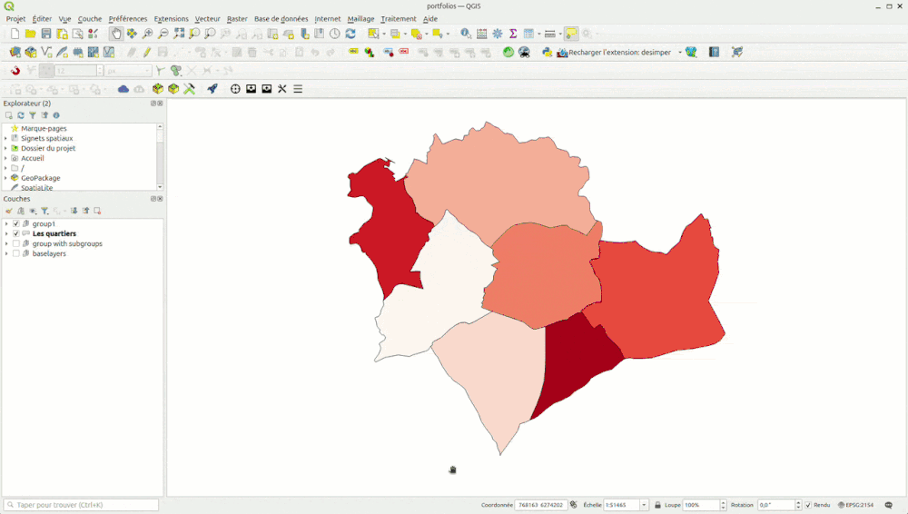

*Financé par la municipalité de Mirandela - Développé par [René-Luc D'Hont](https://github.com/rldhont)*

### Export DXF

Ajout d'un outil d'**export DXF**, configurable via le plugin ([#6247](https://github.com/3liz/lizmap-web-client/pull/6247)).

*Développé par [meyerlor](https://github.com/meyerlor)*

## Améliorations

### Couche WMS

Améliorations du mode **Charger les couches en une seule image WMS** : il est désormais possible d'exclure des couches via le plugin ([#685](https://github.com/3liz/lizmap-plugin/pull/685)), l'opacité des couches est mieux gérée ([#6628](https://github.com/3liz/lizmap-web-client/pull/6628)) et les fonds de carte peuvent être exclus ([#6351](https://github.com/3liz/lizmap-web-client/pull/6351)).

*Développé par [meyerlor](https://github.com/meyerlor)*

### Recherche

Les suggestions de recherche sont plus nombreuses, mieux classées et plus lisibles ([#6733](https://github.com/3liz/lizmap-web-client/pull/6733)). Elles s'affichent directement pendant la saisie ([#6754](https://github.com/3liz/lizmap-web-client/pull/6754)).

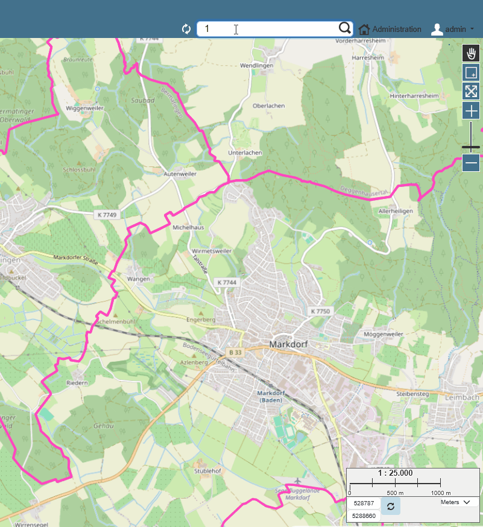

*Développé par [meyerlor](https://github.com/meyerlor)*

### Infobulle

La symbologie QGIS peut désormais être affichée dans les infobulles : par exemple, les icônes d'une couche de points. Au survol, l'icône est agrandie pour un meilleur retour visuel ([#5768](https://github.com/3liz/lizmap-web-client/pull/5768))

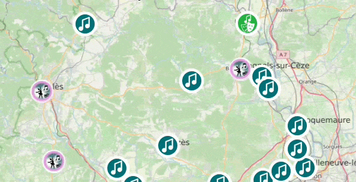

*Financé par le Conseil départemental du Gard - Développé par [Nicolas Boisteault](https://github.com/nboisteault)*

### Popup

* Pour les popups qui suivent la mise en forme glisser-déposer du formulaire, les tableaux compacts des couches enfants sont désormais correctement placés dans le groupe ou l'onglet choisi ([#6821](https://github.com/3liz/lizmap-web-client/pull/6821))

  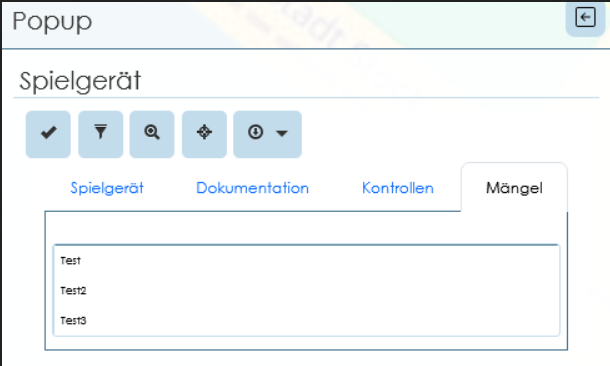

  *Développé par [meyerlor](https://github.com/meyerlor)*

* Nouveau mode pour **regrouper toutes les popups par couche**, dans une vue tabulaire, avec la possibilité de passer d'une popup à la suivante. Ce mode est configurable via le plugin. ([#6716](https://github.com/3liz/lizmap-web-client/pull/6716))

  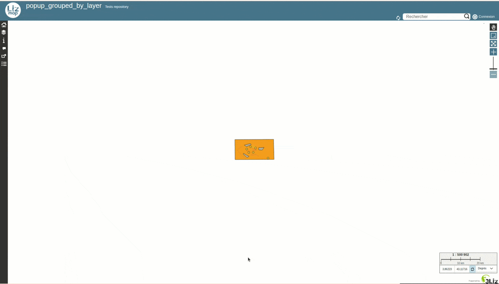

  *Financé par Etra - Développé par [Riccardo Beltrami](https://github.com/mind84)*

### Permalien

Les permaliens utilisent désormais un code très court et sont stockés de façon permanente dans une table système de Lizmap. La symbologie des couches est également prise en compte dans le permalien ([#6886](https://github.com/3liz/lizmap-web-client/pull/6886)).
La liste des permaliens est visible dans l'interface d'administration ([#6765](https://github.com/3liz/lizmap-web-client/pull/6765)).

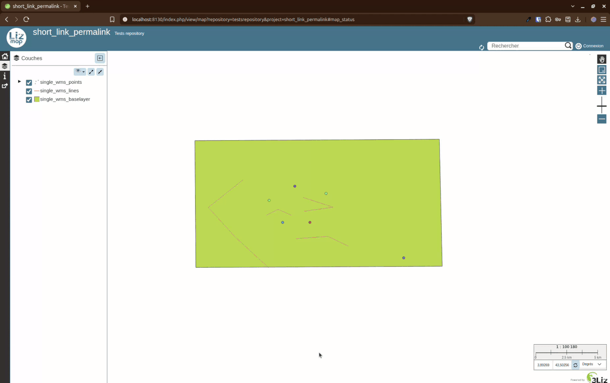

*Financé par Etra - Développé par [Riccardo Beltrami](https://github.com/mind84)*

### Table attributaire

* **Pagination côté serveur**, ce qui permet d'afficher la table attributaire
  pour de gros volumes de données ([#5562](https://github.com/3liz/lizmap-web-client/pull/5562))

* Ajout d'un **outil de requête** pour créer un filtre sur plusieurs champs,
  par exemple pour trouver toutes les entités dont la catégorie est A ou B et dont
  la date de création est postérieure au 1er janvier 2026 ([#5562](https://github.com/3liz/lizmap-web-client/pull/5562)).
  Cet outil permet aussi de créer des **sous-conditions imbriquées** via du JavaScript externe
  (ex. : (A OU B) ET C) ([#6662](https://github.com/3liz/lizmap-web-client/pull/6662))

  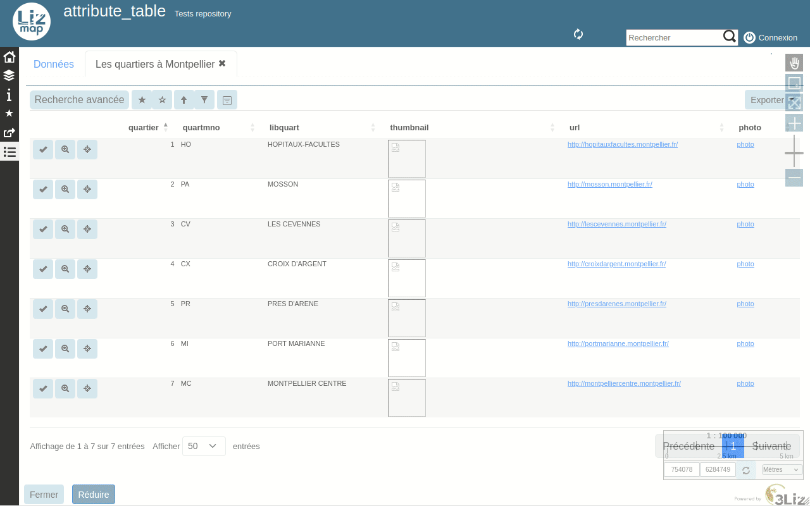

* Cet outil de requête respecte les configurations **liste de valeurs** et
  **relation de valeur** ([#6572](https://github.com/3liz/lizmap-web-client/pull/6572))

* Possibilité de **zoomer sur les entités sélectionnées**
  ([#6609](https://github.com/3liz/lizmap-web-client/pull/6609),
  amélioré par [#6778](https://github.com/3liz/lizmap-web-client/pull/6778))

* Possibilité de **sélectionner toutes les entités filtrées**, y compris celles qui ne sont pas
  affichées sur la page courante ([#6632](https://github.com/3liz/lizmap-web-client/pull/6632))

*Financé par digi-studio, Etra & Faunalia - Développé par [Nicolas Boisteault](https://github.com/nboisteault), [René-Luc D'Hont](https://github.com/rldhont) & [Riccardo Beltrami](https://github.com/mind84)*

### Édition

* Prise en charge des **expressions de valeur par défaut** sur tous les champs :
  les valeurs sont calculées à la création et à la mise à jour (en respectant
  l'option QGIS « Appliquer la valeur par défaut lors de la mise à jour »).
  Les valeurs sont recalculées quand la géométrie ou l'un des champs utilisés
  dans l'expression change.
  Ex. : `"firstname" || ' ' || "lastname"` ou `area(@geometry)`
  ([#6818](https://github.com/3liz/lizmap-web-client/pull/6818))

  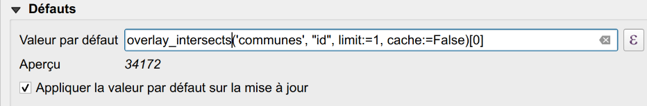

  *Développé par [meyerlor](https://github.com/meyerlor)*

* Nouvelle option pour **activer automatiquement l'accrochage** lors de l'édition
  ([#6603](https://github.com/3liz/lizmap-web-client/pull/6603))
  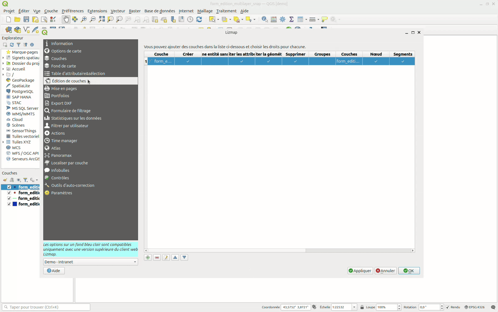

  *Développé par [meyerlor](https://github.com/meyerlor)*

* Un nouvel outil permet de **copier la géométrie** d'une entité visible et de la réutiliser pour l'entité en cours de création : cliquer sur le bouton de copie, puis sur l'entité dans la carte. ([#6405](https://github.com/3liz/lizmap-web-client/pull/6405), boutons copier/coller fusionnés dans [#6613](https://github.com/3liz/lizmap-web-client/pull/6613))

  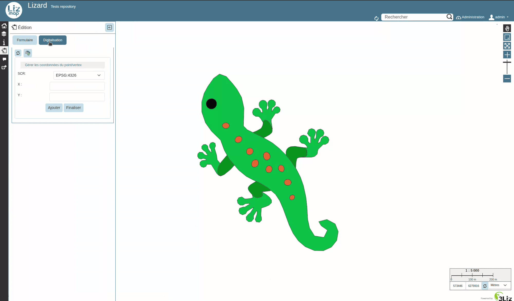

  *Développé par [meyerlor](https://github.com/meyerlor)*

* Lors de la copie d'une géométrie, le sélecteur d'entités affiche désormais le **nom d'affichage de l'entité** défini dans QGIS en plus du nom de la couche, ce qui permet de distinguer des entités superposées

  ([#7210](https://github.com/3liz/lizmap-web-client/pull/7210))

  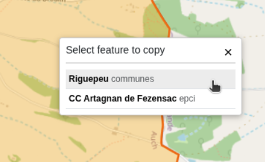

  *Financé par 3Liz - Développé par [Eliott Yvetot](https://github.com/Elioooooott)*

* La **couleur de fond** définie dans QGIS pour les onglets du formulaire
  est désormais utilisée dans le formulaire Lizmap
  ([#6342](https://github.com/3liz/lizmap-web-client/pull/6342))

  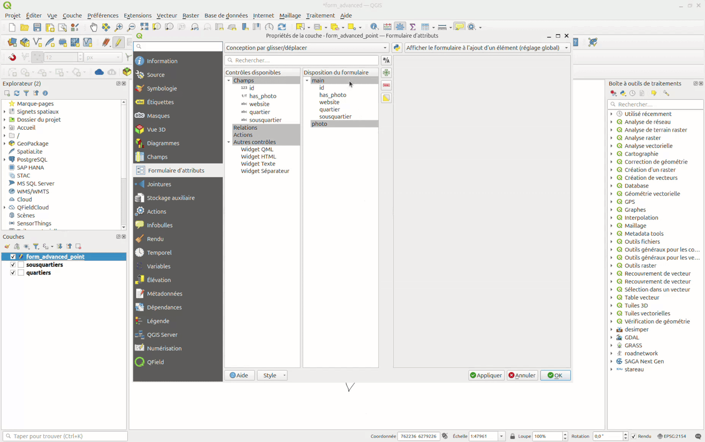

  *Financé par la CC Parthenay-Gâtine - Développé par [Raphaël Martin](https://github.com/nworr)*

* Pour les **pièces jointes et les images**, le nom des fichiers suit désormais la valeur par défaut : le nom d'origine est remplacé par le **résultat de l'expression** ([#6602](https://github.com/3liz/lizmap-web-client/pull/6602)).

  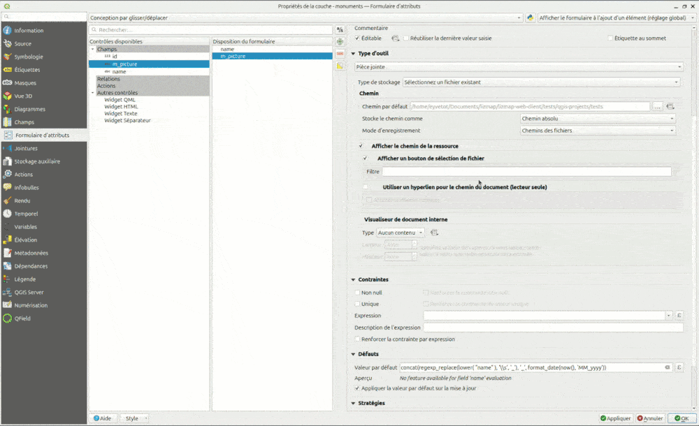

  *Développé par [meyerlor](https://github.com/meyerlor)*

* Prise en charge des **relations plusieurs-à-plusieurs** dans le formulaire,
  en s'appuyant sur la cardinalité définie sur `attributeEditorRelation` dans QGIS
  ([#6806](https://github.com/3liz/lizmap-web-client/pull/6806))

  *Financé par Etra - Développé par [Riccardo Beltrami](https://github.com/mind84)*

### Légende

Un **double-clic** sur la case à cocher d'une couche coche ou décoche toutes ses classes de symbologie ([#6640](https://github.com/3liz/lizmap-web-client/pull/6640)).

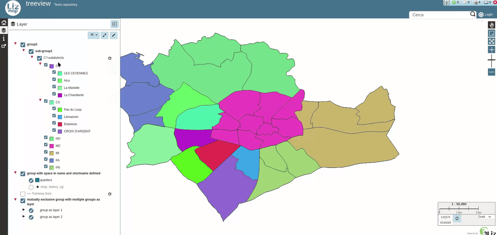

*Financé par Etra - Développé par [Riccardo Beltrami](https://github.com/mind84)*

### Impression

* L'**échelle d'impression** peut être choisie indépendamment des échelles d'affichage :
  l'utilisateur peut imprimer à une échelle personnalisée.
  ([#6653](https://github.com/3liz/lizmap-web-client/pull/6653))

  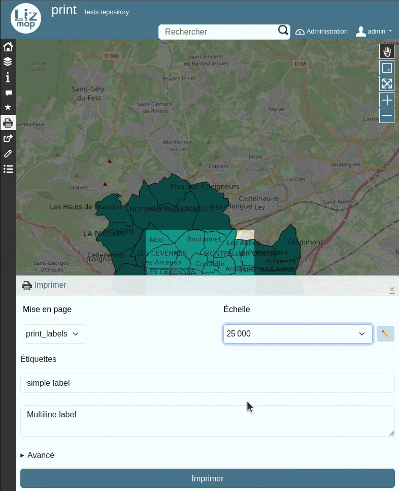

  *Financé par la CC Bièvre Est - Développé par [Nicolas Boisteault](https://github.com/nboisteault)*

* Le **nom du fichier PDF exporté** pour une seule entité d'atlas respecte désormais la configuration
  (à l'aide d'expressions QGIS) ([#6224](https://github.com/3liz/lizmap-web-client/pull/6224))

  *Développé par [meyerlor](https://github.com/meyerlor)*

* Possibilité d'exporter un PDF **avec plusieurs entités d'atlas** en une seule fois
  en sélectionnant des entités d'une même couche. ([#6224](https://github.com/3liz/lizmap-web-client/pull/6224))

  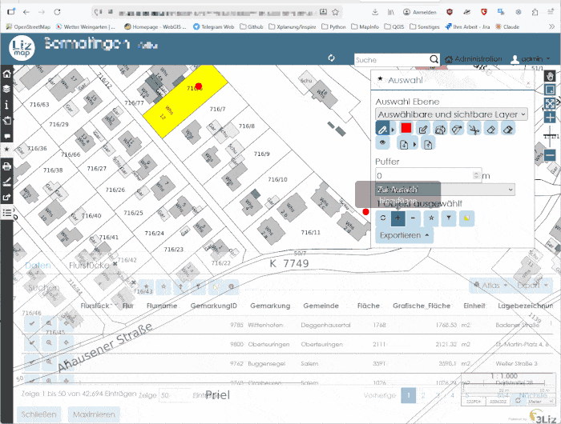

  *Développé par [meyerlor](https://github.com/meyerlor)*

### Sélection

L'**outil de sélection par rectangle** est désormais activé automatiquement à l'affichage du panneau de sélection ([#6614](https://github.com/3liz/lizmap-web-client/pull/6614))

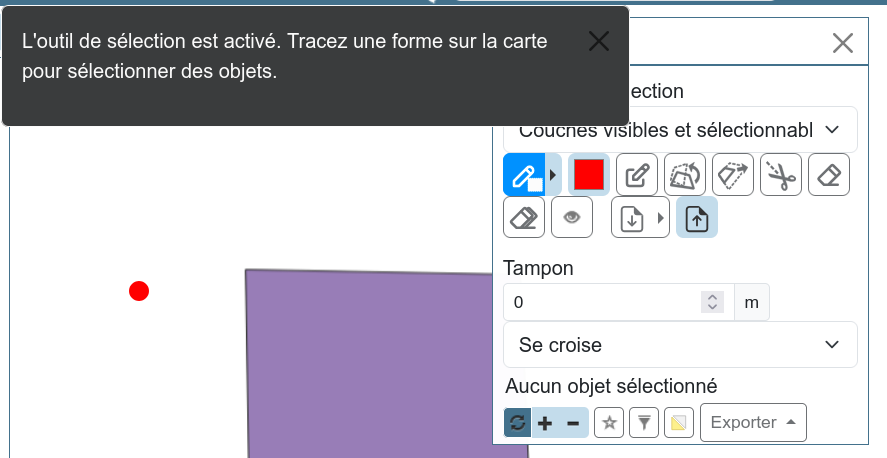

*Développé par [meyerlor](https://github.com/meyerlor)*

## Développeurs

### Actions

Possibilité d'envoyer des **paramètres dynamiques depuis JavaScript** lors du déclenchement d'une action ([#6917](https://github.com/3liz/lizmap-web-client/pull/6917))

*Financé par 3Liz - Développé par [Eliott Yvetot](https://github.com/Elioooooott)*

### JavaScript

Reprojection : utilisation de la bibliothèque **proj4rs**, un équivalent de proj4js écrit en **Rust** : https://github.com/3liz/proj4rs ([#5799](https://github.com/3liz/lizmap-web-client/pull/5799))

*Financé par 3Liz - Développé par [René-Luc D'Hont](https://github.com/rldhont)*

### Interface

Migration vers **Bootstrap 5** ([#4455](https://github.com/3liz/lizmap-web-client/pull/4455), complétée par [#6924](https://github.com/3liz/lizmap-web-client/pull/6924) et de nombreuses
  corrections tout au long du cycle 3.10)

*Financé par 3Liz - Développé par [Nicolas Boisteault](https://github.com/nboisteault)*

## Changements non rétrocompatibles

Suite à un changement du format de stockage du cache des tuiles, un cache pré-généré avec une version antérieure à la 3.10 n'est plus utilisé après la mise à jour. Il faut regénérer le cache (l'ancien cache orphelin peut être supprimé) ([#7183](https://github.com/3liz/lizmap-web-client/issues/7183)).

## Migrer ses scripts et ses popups

Lizmap 3.10 modifie la séquence de démarrage JavaScript, certaines API JavaScript publiques, ainsi que le HTML de
l'interface avec la migration vers **Bootstrap 5**. Si vous utilisez des **scripts JavaScript externes** (dossier `media/js/`)
ou du **HTML personnalisé** dans les popups, consultez le [guide de migration de la 3.9 vers la 3.10](migration_3.10_fr.md) :
il liste ce qu'il faut modifier (événements, API, classes, éléments HTML et sélecteurs) et fournit
un modèle de script compatible avec la 3.10.
